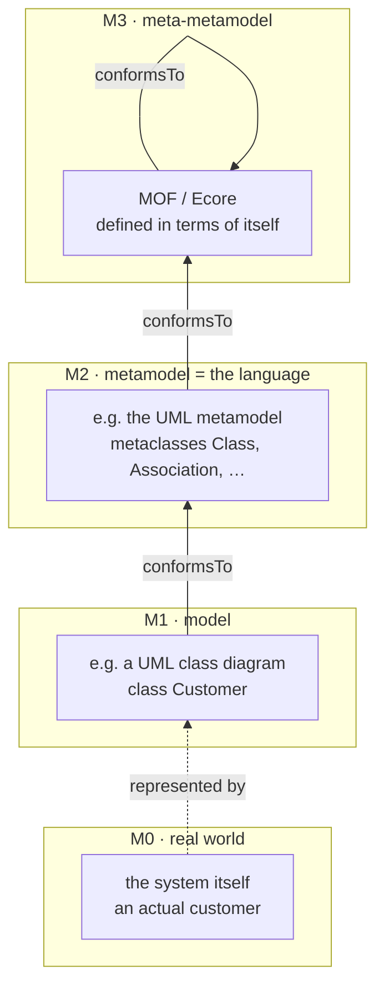
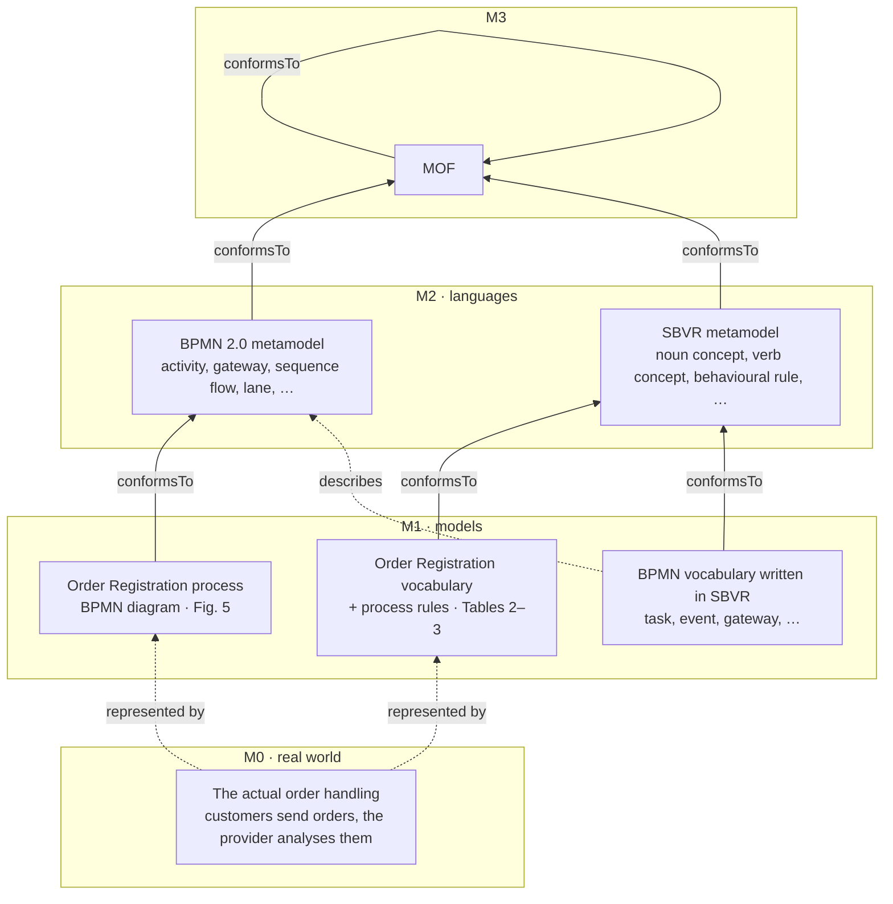
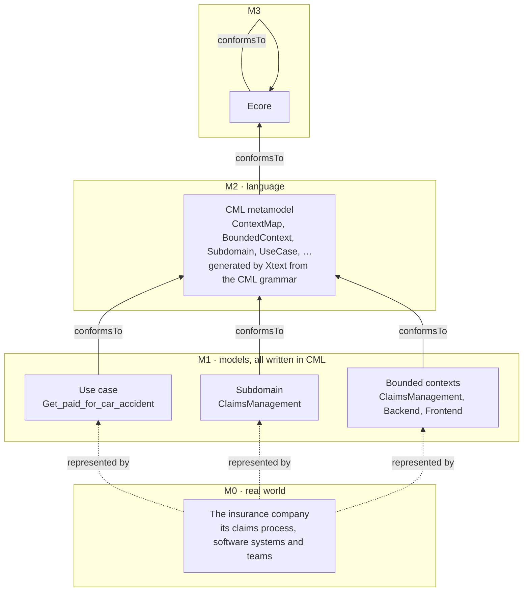
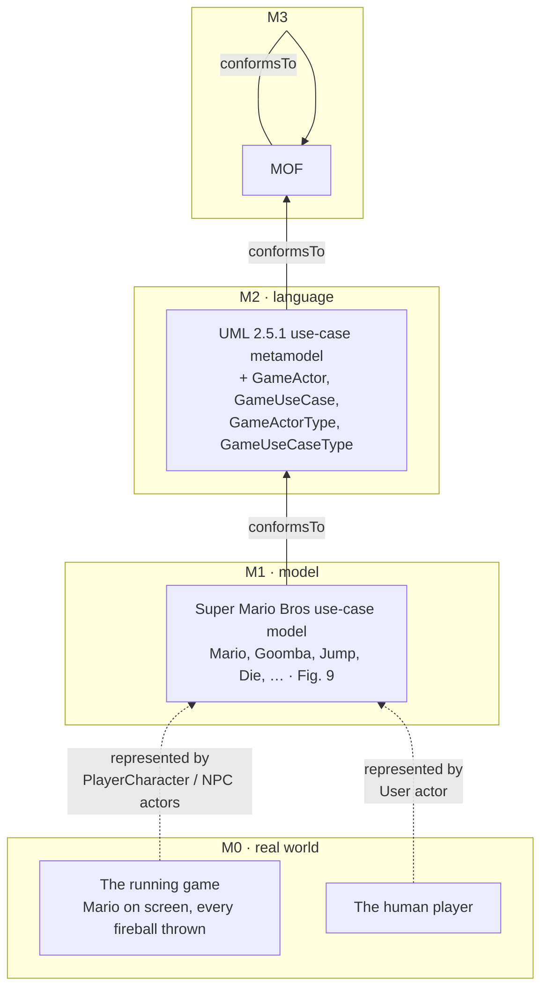

# The four meta-levels in each paper

**How to read the diagrams:**
- **M3** (meta-metamodel) is at the top and **M0** (the real world) at the bottom.
- Solid arrows are **conformsTo**: a model is written in the language one level up.
- Dotted arrows from M0 are **represented by**: the real thing is described by the model.

## The general idea

---

## 1. BPMN → SBVR

- The transformation T1–T9 runs **at M1**: it reads the BPMN model and writes the SBVR model. It is *defined* against the two M2 metamodels.
- **The BPMN vocabulary is the odd one.** It is an M1 model (written in SBVR) whose subject is the M2 BPMN metamodel, so it is a model of a metamodel. The Order Registration vocabulary imports it.
- In MagicDraw, both M2 languages are implemented as **UML profiles** on the UML metamodel.

---

## 2. Context Mapper

- The whole transformation chain (use case → subdomain → bounded contexts) stays **inside M1**, because every model conforms to the same CML metamodel.
- Going from requirements to design to deployment changes the **abstraction level** (CIM → PIM → PSM), **not the meta-level**.

---

## 3. Game use-case modeling

- **M0 has two kinds of things.** Software entities inside the game are represented by actors drawn *inside* the system boundary. The real person playing is represented by the *User* actor, drawn outside it.
- **One actor can stand for many runtime objects.** The single *Fireball* actor at M1 stands for every fireball created during play at M0.

---

## Side by side

| Level | BPMN → SBVR | Context Mapper | Game use cases |
|---|---|---|---|
| **M3** | MOF | Ecore | MOF |
| **M2** | BPMN 2.0 and SBVR metamodels | CML metamodel | UML use-case metamodel + game extension |
| **M1** | Order Registration BPMN model; SBVR vocabulary and rules; BPMN vocabulary | Use case, subdomain, bounded contexts (insurance example) | Super Mario use-case model |
| **M0** | Real order handling | The insurance company's systems and teams | The running game and its players |
