# Transformation diagrams for the three papers

Mermaid diagrams of each paper's transformations: chain, metamodel-based pattern, rule tree, dependencies, levels. Each section ends with a table of transformation properties: cardinality, direction, in-place/out-place, and so on.

Text versions of the same material are in [mde-breakdown.md](mde-breakdown.md).

**Legend** (used in every diagram):

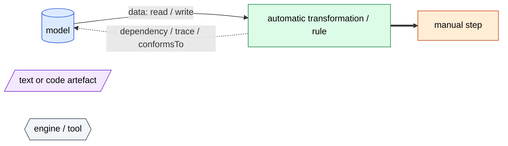

Thick arrows (`==>`) show execution order, plain arrows show data flow, and dotted arrows show dependencies, traces or conformance.

**In-place vs out-place:** an *out-place* transformation creates a new target model and leaves the source untouched. An *in-place* transformation modifies the source model itself, so source and target are the same model.

---

## 1. BPMN → SBVR process rules

### 1.1 Transformation chain (Fig. 1, p. 6)

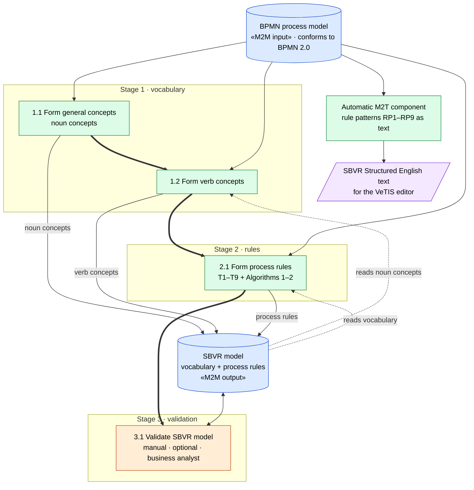

Stage 1 comes from the authors' earlier papers; Stage 2 is the contribution of this paper. Stage 2 has **two inputs**, the BPMN model and the vocabulary already in the SBVR model. It writes back into that same SBVR model.

### 1.2 Metamodel-based transformation pattern

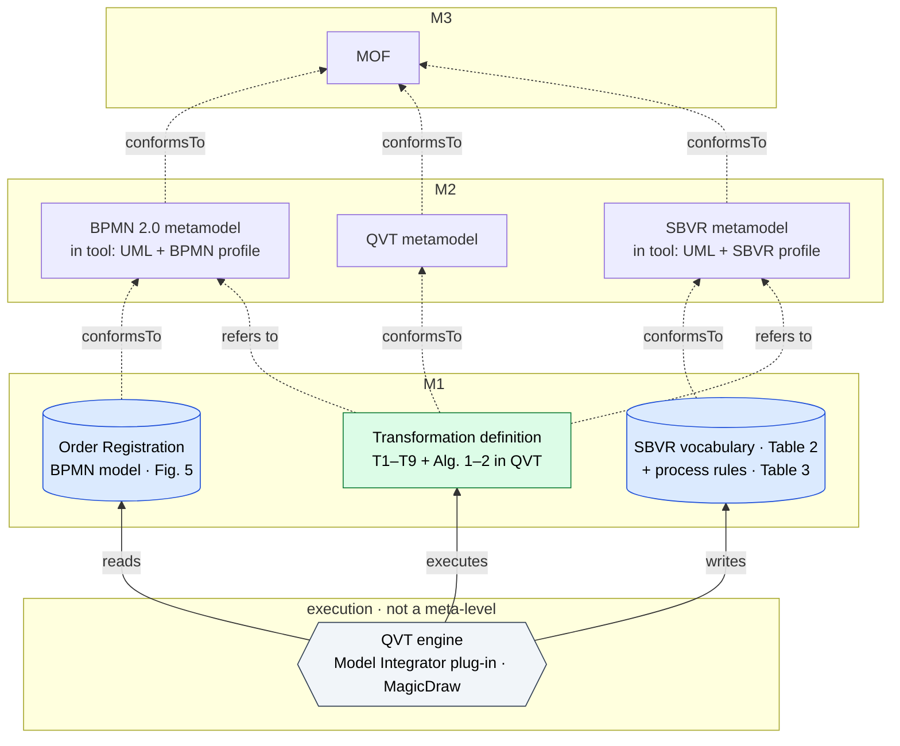

### 1.3 Rule tree: BPMN pattern → rule → SBVR rule pattern and modality (Table 1)

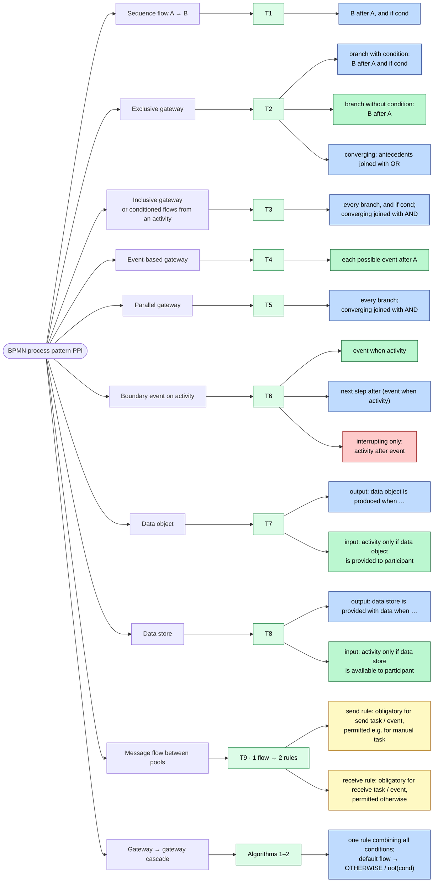

Colours: **blue = obligatory**, **green = permitted**, **red = prohibited**, **yellow = depends on the node type**.

**Element-level cardinality differs per rule:**
- T1: 1 flow → 1 rule
- T2–T5: 1 gateway → one rule per branch
- T9: 1 message flow → 2 rules
- cascades: N gateways → 1 rule

### 1.4 Dependencies: vocabulary, rules and the cascading-gateway recursion (§3.1, §3.3)

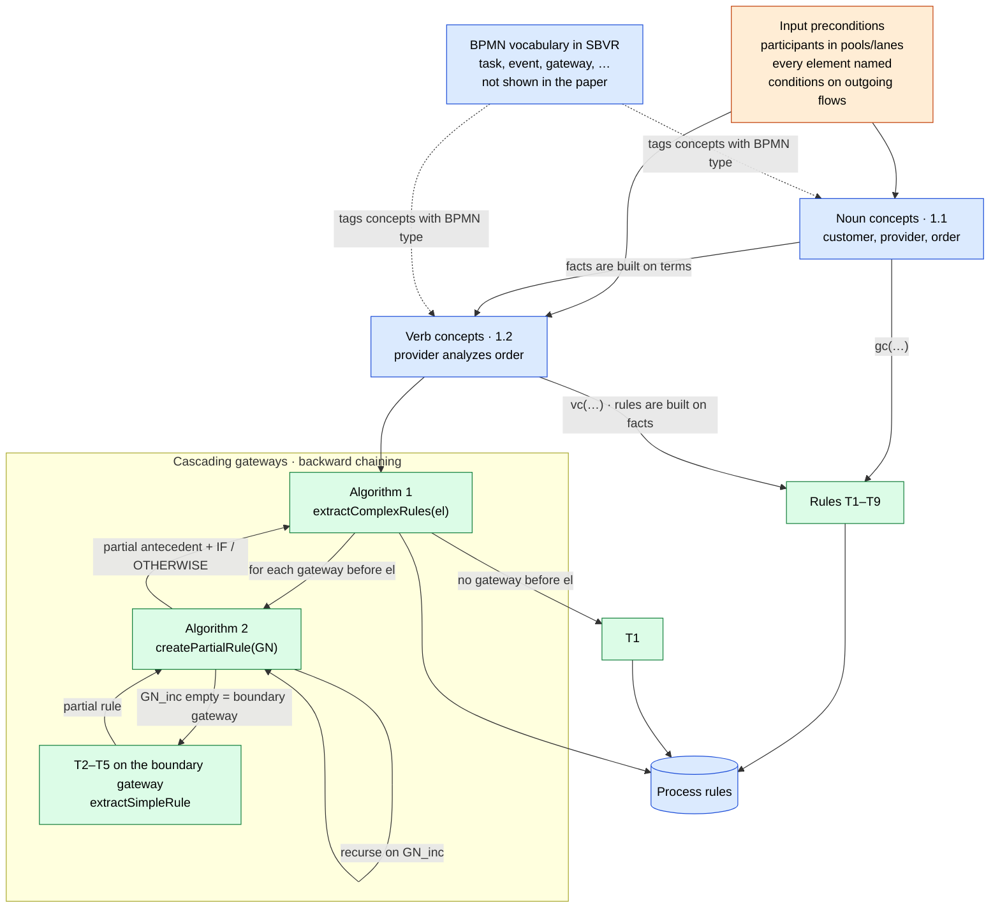

### 1.5 Tool interaction (Fig. 2, p. 17)

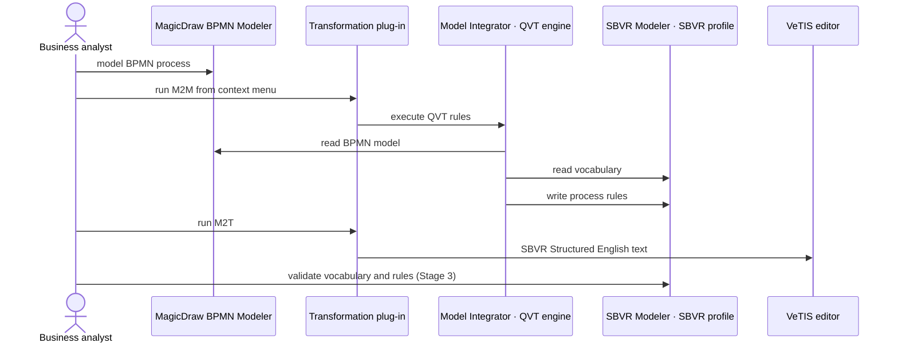

### 1.6 Properties

| Property | Value | Source |
|---|---|---|
| Kind | M2M (BPMN → SBVR model) **and** M2T (BPMN → Structured English) | paper |
| Source / target metamodels | BPMN 2.0 / SBVR | paper |
| Endogenous / exogenous | Exogenous; arguably endogenous in the tool, where both are UML profiles | paper / my remark |
| Horizontal / vertical | Horizontal (CIM → CIM) | paper |
| Model cardinality | One-to-one per the authors; Stage 2 actually reads BPMN + vocabulary, so N-to-1 | paper / Fig. 1 |
| Element cardinality | 1→1 (T1), 1→n (T2–T5 per branch, T9 → 2 rules), n→1 (cascades) | Table 1, §3.3 |
| Direction | Unidirectional; SBVR → BPMN is future work | paper |
| In-place / out-place | Out-place for BPMN (read-only). **In-place update** of the SBVR model: Stage 2 adds rules to the vocabulary model | inferred from Fig. 1 |
| Style | Hybrid: declarative patterns + imperative recursion | paper |
| Rule scheduling | Deterministic; Stage 1 must finish before Stage 2 | paper |
| Automation | Stages 1–2 automatic, Stage 3 manual and optional | paper |
| Traceability | Concepts carry meta-information on their originating BPMN type; QVT trace implicit | §3.2 |
| Incremental | Not discussed | — |
| Language / engine | QVT / Model Integrator plug-in in MagicDraw | paper |

---

## 2. Context Mapper

### 2.1 Transformation chain (Fig. 3, p. 262)

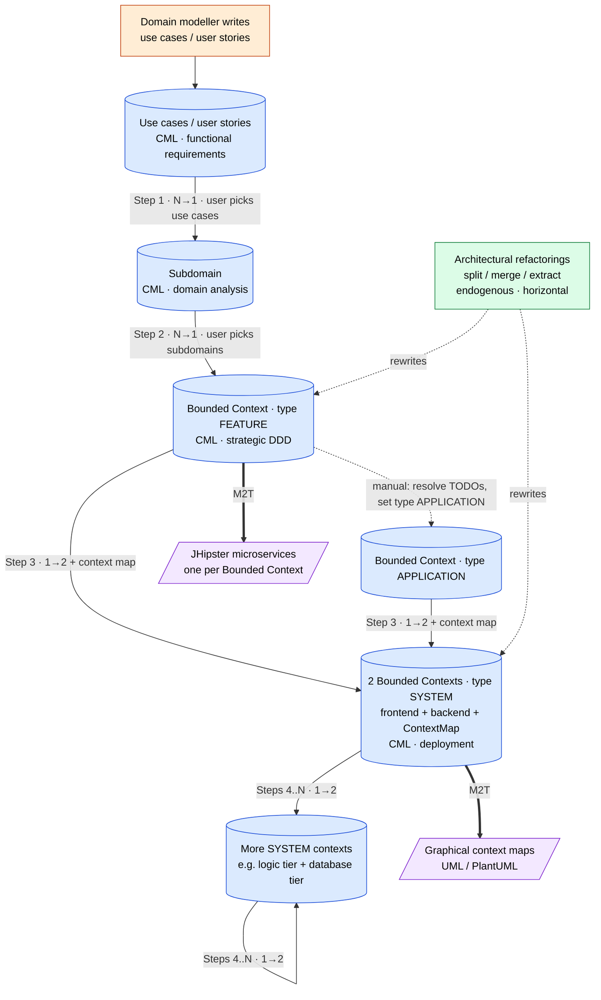

### 2.2 Element-level derivation and trace links for the worked example (Listings 5.1–5.4)

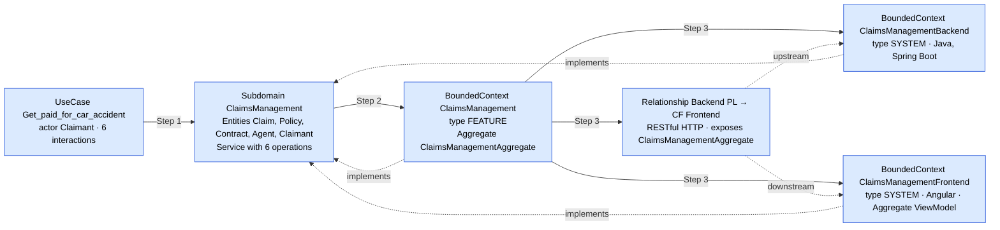

The `implements` links are **explicit trace links stored in the model**. They point back to the subdomain whatever step created the context.

### 2.3 Step 1 mapping: interaction → subdomain elements (Fig. 4, p. 264)

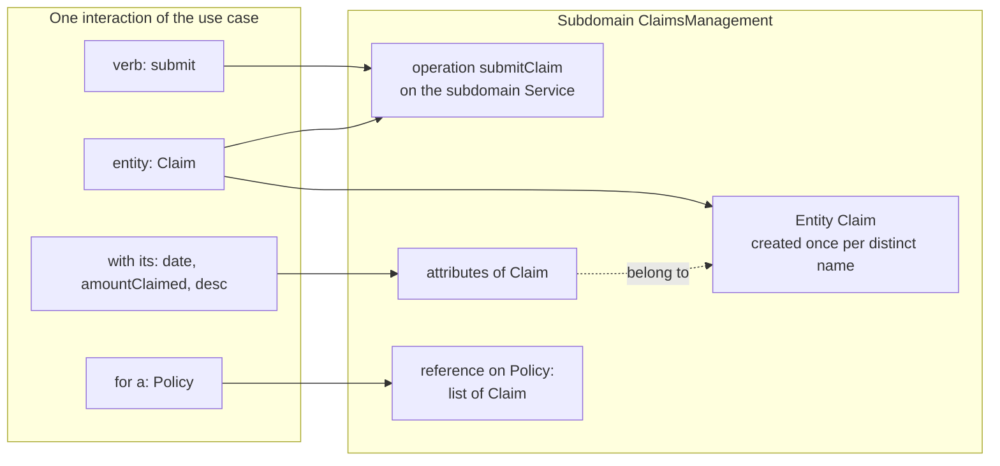

Entities that appear in several interactions are **merged by name**: `Claim` gets contributions from interactions 1, 3 and 6. There is **one operation per interaction**.

### 2.4 Metamodel-based transformation pattern (endogenous)

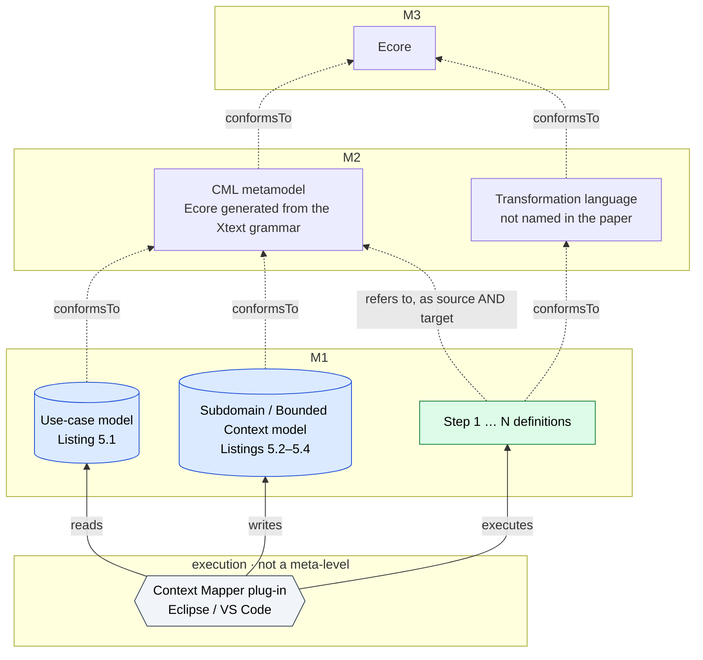

### 2.5 Abstraction levels vs meta-levels: vertical **and** endogenous

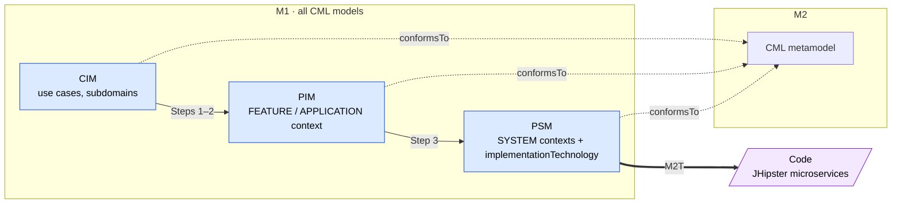

The chain goes **down in abstraction** while every model **conforms to the same metamodel**. The abstraction level is encoded in the context `type` and `implementationTechnology`, not in a change of language.

### 2.6 Properties

| Property | Rapid-prototyping steps | Architectural refactorings | Code / diagram generation | Source |
|---|---|---|---|---|
| Kind | M2M | M2M | M2T | paper |
| Source / target metamodels | CML / CML | CML / CML | CML / Java project, diagrams | paper |
| Endogenous / exogenous | Endogenous | Endogenous | Exogenous (to text) | paper |
| Horizontal / vertical | Vertical | Horizontal | Vertical | my classification |
| Model cardinality | Step 1 N→1, Step 2 N→1, Step 3 1→2 (+ map), Steps 4..N 1→2 | split 1→2, merge 2→1, extract 1→2 | 1 BC → 1 microservice | paper |
| Direction | Unidirectional | Unidirectional | Unidirectional; reverse engineering from code is future work | paper |
| In-place / out-place | **In-place update**: derived elements are added to the same CML model, inputs kept | **In-place**: the CML model is rewritten | Out-place | inferred (not stated) |
| Automation | Semi-automatic: user selects inputs, output has `TODO` hints | Semi-automatic | Automatic | paper |
| Traceability | Explicit `implements` (BC → Subdomain); `exposedAggregates` on relationships | — | — | listings |
| Incremental | Not discussed | — | — | — |
| Language / engine | Not named / Context Mapper plug-in | Not named | JHipster | paper |

---

## 3. Game use-case modeling

**The paper defines no transformations.** The diagrams show what the tool does, the metamodel any transformation would read, the constraint tree, and a *proposed* chain (my proposal, marked as such).

### 3.1 What GUCM does (§5, p. 92–95)

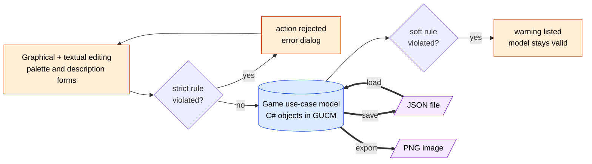

Saving and loading are **serialisation**, not transformation. PNG export renders the concrete syntax.

### 3.2 Source metamodel for any transformation (Fig. 1, p. 89, simplified)

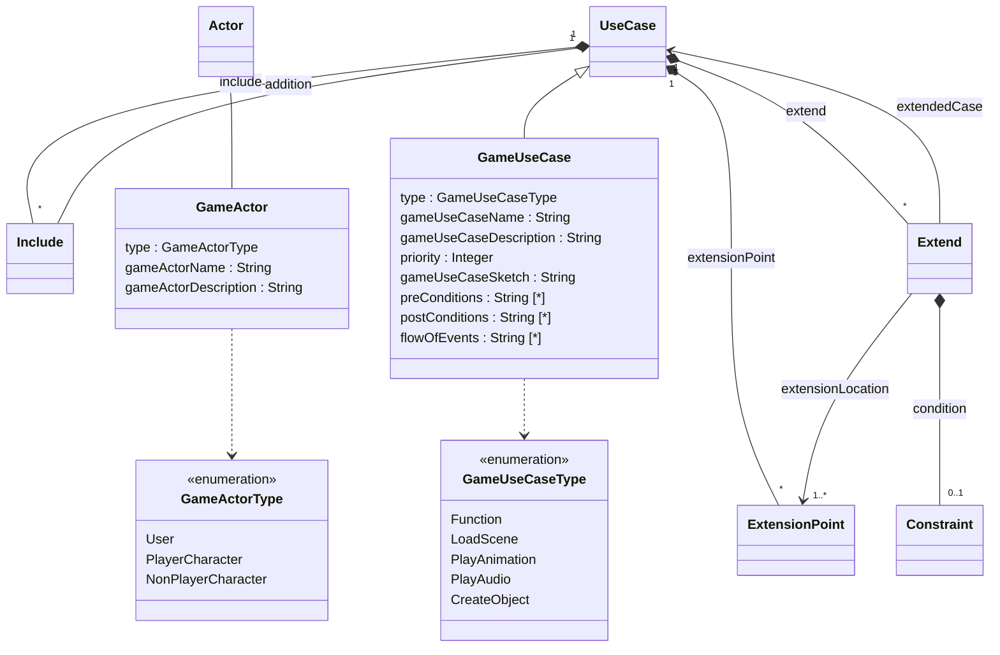

### 3.3 Well-formedness rule tree (§4.2, p. 91–92)

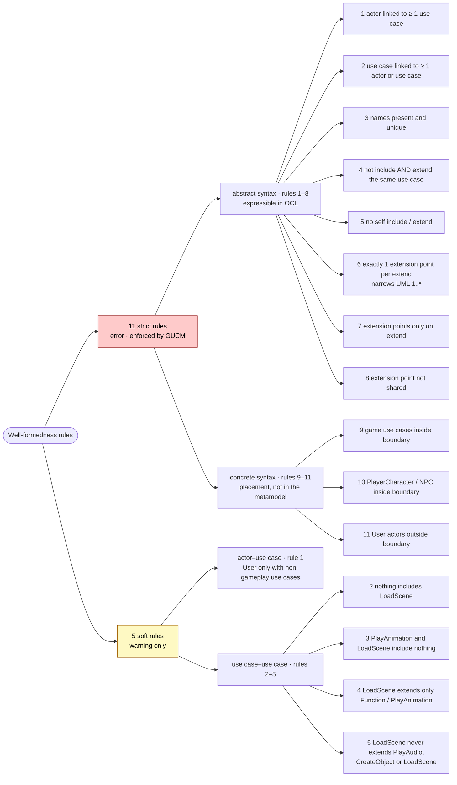

**Which relationships the soft rules allow between use-case types** (row → column):

| includes → | Function | LoadScene | PlayAnimation | PlayAudio | CreateObject |
|---|---|---|---|---|---|
| **Function** | ✓ | ✗ | ✓ | ✓ | ✓ |
| **PlayAudio** | ✓ | ✗ | ✓ | ✓ | ✓ |
| **CreateObject** | ✓ | ✗ | ✓ | ✓ | ✓ |
| **PlayAnimation** | ✗ | ✗ | ✗ | ✗ | ✗ |
| **LoadScene** | ✗ | ✗ | ✗ | ✗ | ✗ |

| extends → | Function | LoadScene | PlayAnimation | PlayAudio | CreateObject |
|---|---|---|---|---|---|
| **LoadScene** | ✓ | ✗ | ✓ | ✗ | ✗ |
| **any other type** | ✓ | ✓ | ✓ | ✓ | ✓ |

### 3.4 Proposed transformation chain (my proposal; the paper only hints at it on p. 85 and p. 111)

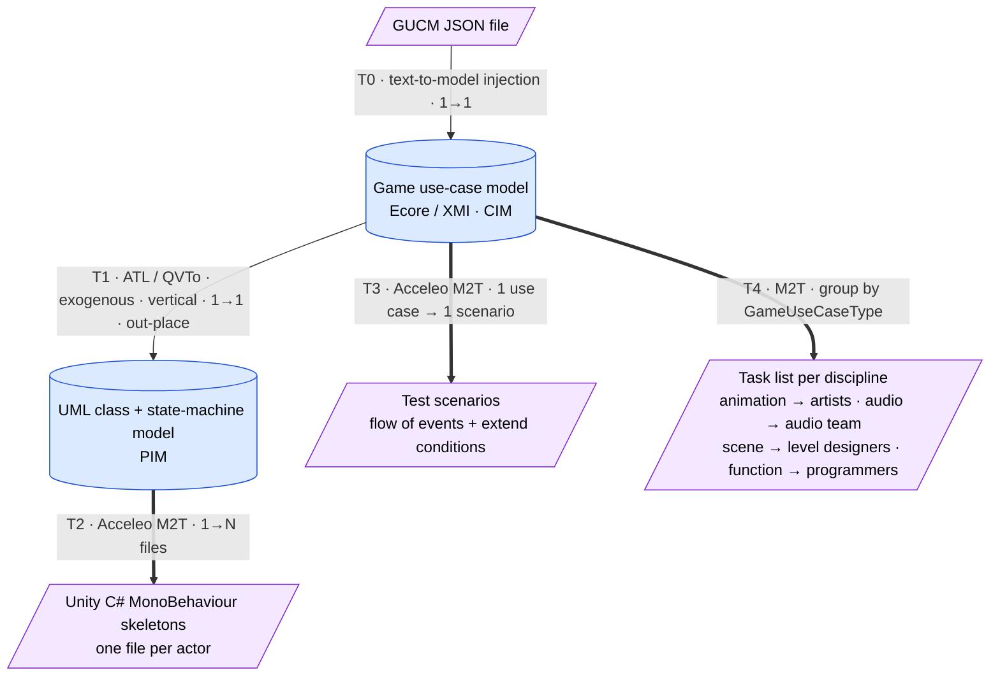

### 3.5 Properties (of the proposed chain)

| Property | T1 GameUC → UML | T2 UML → C# | T3 GameUC → tests |
|---|---|---|---|
| Kind | M2M | M2T | M2T |
| Endogenous / exogenous | Exogenous | Exogenous | Exogenous |
| Horizontal / vertical | Vertical (CIM → PIM) | Vertical (PIM → code) | Horizontal (same requirements, different form) |
| Cardinality | 1→1 model; per element `Function` → operation, `extend` + condition → guarded transition | 1 model → N files | 1 use case (+ its extends) → 1 scenario |
| Direction | Unidirectional | Unidirectional | Unidirectional |
| In-place / out-place | Out-place | Out-place | Out-place |

---

## 4. Cross-paper view

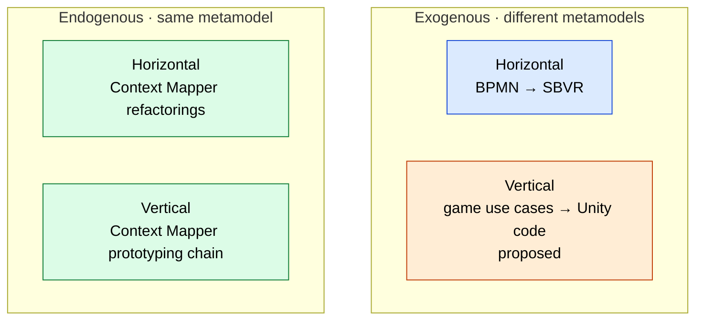

| | BPMN → SBVR | Context Mapper | Game use cases |
|---|---|---|---|
| Transformations | M2M + M2T | M2M chain + refactorings + M2T | none (proposed only) |
| Exo / endo | exogenous | endogenous | — |
| Horizontal / vertical | horizontal | vertical + horizontal | — |
| Model cardinality | 1-1 claimed, N-1 in practice | N-1, N-1, 1-2, 1-2 | — |
| Direction | unidirectional | unidirectional | — |
| In-place / out-place | out-place for BPMN, in-place update of SBVR | in-place update of the CML model (inferred) | — |
| Style | hybrid | not stated | — |
| Human in the loop | optional validation | input selection + `TODO` refinement | all modelling is manual |
| Traceability | BPMN type tags on concepts | explicit `implements` links | — |
